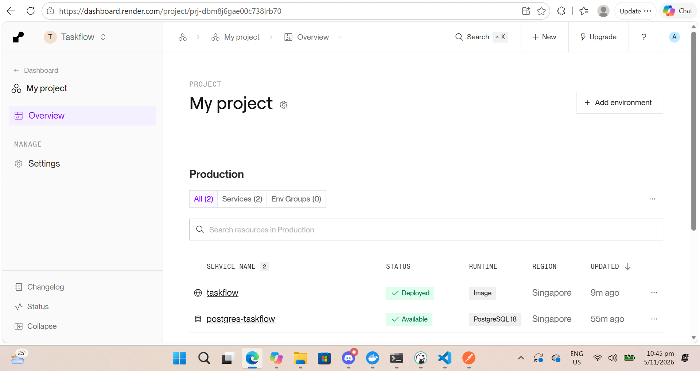
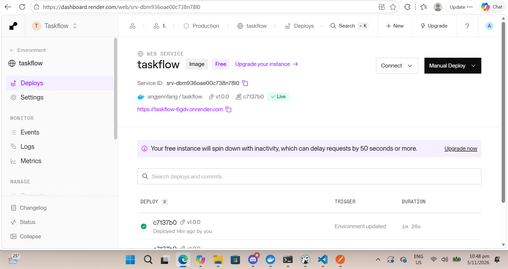
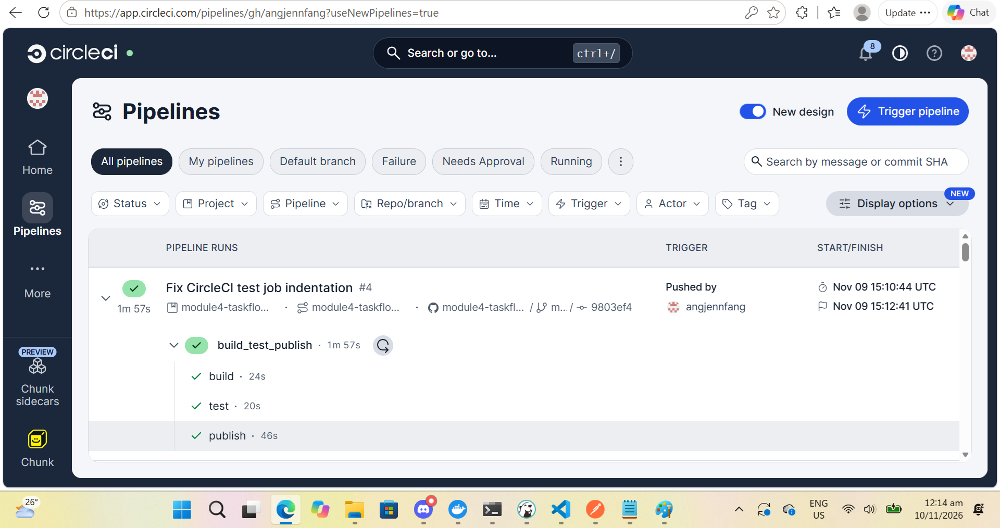
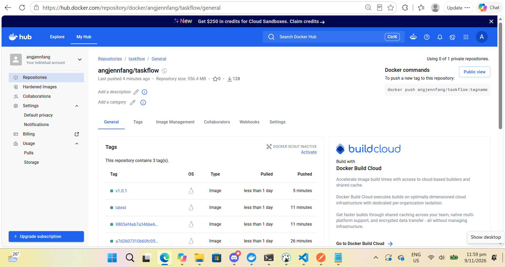

# Taskflow API

A Java REST API for managing tasks. Built with Spring Boot, it provides endpoints to create, retrieve, update, complete, and delete tasks. It can also generate a plain-English task summary using Spring AI and an OpenRouter-compatible chat model.

## Live application

Hosting platform: Render

This deployment uses Render rather than Railway.

### GET endpoints

Click these links to view the responses:

- [List All Tasks](https://taskflow-6gdv.onrender.com/api/tasks)
- [Get Task 1](https://taskflow-6gdv.onrender.com/api/tasks/1)
- [AI Task Summary](https://taskflow-6gdv.onrender.com/api/tasks/summary)

### Create a task - POST

Run in your terminal:

```bash
curl -i -X POST https://taskflow-6gdv.onrender.com/api/tasks \
  -H "Content-Type: application/json" \
  -d '{"title":"Test task","description":"Test the live API","completed":false}'
```

Use the ID returned when creating a task instead of `1` below.
The "Get Task 1" link also requires a task with ID 1 to exist.

### Update a task - PUT

```bash
curl -i -X PUT https://taskflow-6gdv.onrender.com/api/tasks/1 \
  -H "Content-Type: application/json" \
  -d '{"title":"Updated task","description":"Updated description","completed":false}'
```

### Mark a task as complete - PUT

```bash
curl -i -X PUT https://taskflow-6gdv.onrender.com/api/tasks/1/complete
```

### Delete a task - DELETE

```bash
curl -i -X DELETE https://taskflow-6gdv.onrender.com/api/tasks/1
```

**Notes:**

- Browser links send GET requests only.
- The AI summary requires `OPENROUTER_API_KEY` to be configured on Render.
- Tasks are stored in memory and disappear when the application restarts.

## Screenshots

### Render deployment dashboard



### Live tasks API



## Key features

- Create tasks with a title and description.
- Retrieve all tasks or look up a task by ID.
- Update task details and completion status.
- Mark a task as complete.
- Delete a task.
- Generate an AI summary of the current tasks.
- Build, test, and run the project with the included Maven Wrapper.

> **Note:** Tasks are stored in memory, not in a database. They are lost when the application stops or restarts.

## Prerequisites

- Java Development Kit (JDK) 21.
- An OpenRouter API key for the AI-powered task summary endpoint.
- Internet access so Maven can download dependencies.

## Installation and setup

1. Clone the repository and change into the project directory:

   ```bash
   git clone <repository-url>
   cd module4-taskflow-api
   ```

2. Set your OpenRouter API key as an environment variable. Do not commit your key to the repository.

   **macOS / Linux**

   ```bash
   export OPENROUTER_API_KEY="your-api-key"
   ```

   **Windows PowerShell**

   ```powershell
   $env:OPENROUTER_API_KEY = "your-api-key"
   ```

3. Run the tests:

   ```bash
   ./mvnw test
   ```

   On Windows:

   ```powershell
   .\mvnw.cmd test
   ```

4. Start the application:

   ```bash
   ./mvnw spring-boot:run
   ```

   On Windows:

   ```powershell
   .\mvnw.cmd spring-boot:run
   ```

The API is available at `http://localhost:8080`.

## API endpoints

All task endpoints use the `/api/tasks` base path.

| Method | Endpoint | Description |
| --- | --- | --- |
| `GET` | `/api/tasks` | List all tasks |
| `GET` | `/api/tasks/{id}` | Get a task by ID |
| `POST` | `/api/tasks` | Create a task |
| `PUT` | `/api/tasks/{id}` | Update a task |
| `DELETE` | `/api/tasks/{id}` | Delete a task |
| `PUT` | `/api/tasks/{id}/complete` | Mark a task as complete |
| `GET` | `/api/tasks/summary` | Generate an AI summary of tasks |

### Example: create a task

```bash
curl -X POST http://localhost:8080/api/tasks \
  -H "Content-Type: application/json" \
  -d '{
    "title": "Prepare project README",
    "description": "Document setup and API endpoints",
    "completed": false
  }'
```

### Example: list tasks

```bash
curl http://localhost:8080/api/tasks
```

### Example: mark a task as complete

```bash
curl -X PUT http://localhost:8080/api/tasks/1/complete
```

### Example: generate an AI task summary

```bash
curl http://localhost:8080/api/tasks/summary
```

The summary endpoint requires `OPENROUTER_API_KEY` to be set.

## Stretch goal: CI pipeline

### Chosen option

Option 1: Add a CI pipeline using CircleCI, following Lesson 4.7.

### What I built

On every push to `main`, CircleCI runs three jobs in sequence:

1. **Build:** Compile and package the TaskFlow API using Java 21 and the Maven Wrapper.
2. **Test:** Run controller, application-context, and database persistence tests using a temporary PostgreSQL 16 database.
3. **Publish:** Build a Linux AMD64 Docker image and publish it to Docker Hub.

If building or testing fails, the image is not published.

The pipeline builds one image with two tags:

- `angjennfang/taskflow:latest`
- `angjennfang/taskflow:<commit-sha>`

Both tags refer to the same image for that pipeline run. The commit-SHA tag identifies the source commit, while `latest` is updated on each successful publication.

The successful PostgreSQL build was also manually tagged and published as `angjennfang/taskflow:v1.0.1`.

### Automated testing

- Controller tests verify task-list responses, missing-task responses, and AI summary responses using a mocked service.
- The application-context test verifies that Spring starts.
- The repository test saves and reloads a task from PostgreSQL, then rolls back the test data.

The mocked AI summary test does not call OpenRouter. CI uses a placeholder AI key and a disposable database; production credentials are not required.

### Credentials and security

Docker Hub credentials are stored in the CircleCI context `taskflow-api`:

- `DOCKERHUB_USERNAME`
- `DOCKERHUB_TOKEN`

The Docker Hub access token is stored as a secret environment variable, not committed to the repository.

Production database credentials and the real OpenRouter API key are configured separately in Render's environment settings.

### CI and deployment

The two processes work side by side:

- **CI:** Push to GitHub main -> CircleCI build -> test -> Docker Hub
- **Deployment:** Select the published Docker image -> deploy on Render

Render is used instead of Railway, as approved.

Publishing an image to Docker Hub does not automatically redeploy the Render service. Deployment is triggered separately using the selected image tag.

Release image: `docker.io/angjennfang/taskflow:v1.0.1`

### Links

- Successful CircleCI run: **TODO: add the URL of the successful PostgreSQL pipeline run before submission.**
- [CircleCI configuration](.circleci/config.yml)
- [Docker Hub image](https://hub.docker.com/r/angjennfang/taskflow)
- [Published image tags](https://hub.docker.com/r/angjennfang/taskflow/tags)
- [Live Tasks API](https://taskflow-6gdv.onrender.com/api/tasks)

### Successful CircleCI run screenshot



### Docker Hub screenshot



## Technology stack

- Java 21
- Spring Boot
- Spring Web MVC
- Spring AI
- OpenRouter-compatible chat API
- Maven Wrapper
